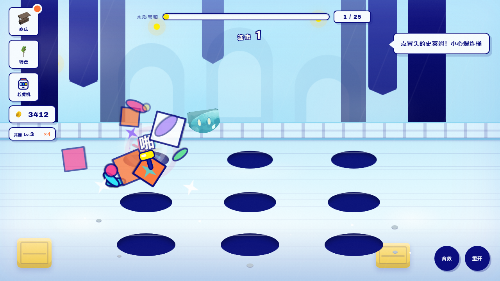
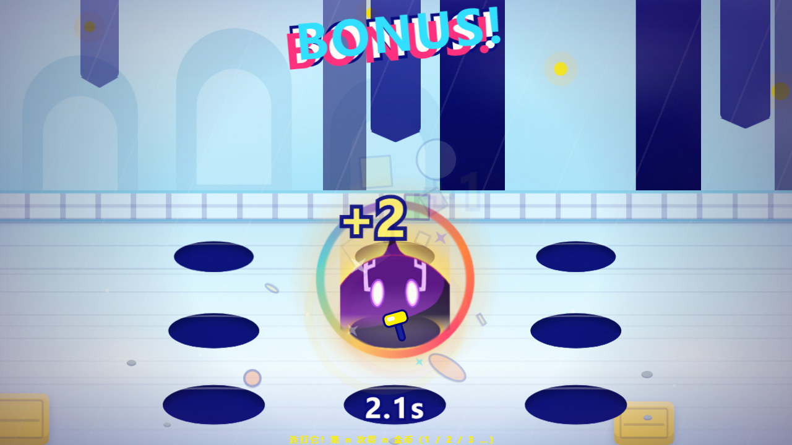
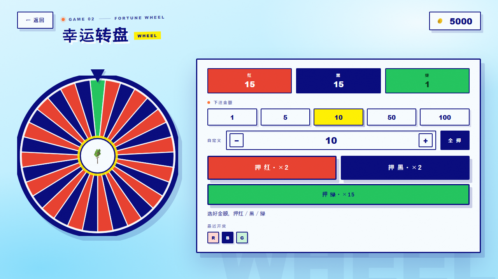
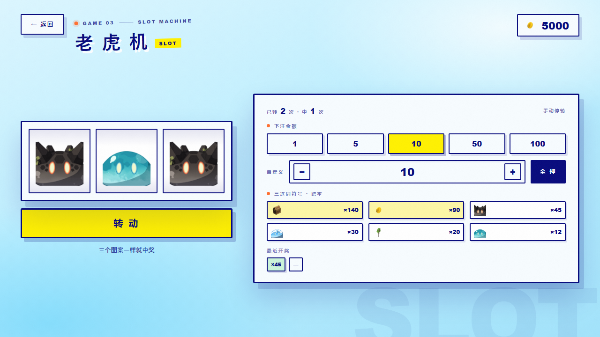

<p align="center">
  
</p>

# 地鼠节拍 · Mole Beat

> 先在网页里把「打地鼠」的手感做出来，再 1:1 搬进《原神》千星奇域（UGC 编辑器）。
> 仓库里两套实现都在：**双击就能玩**的网页原型，和跑在千星里的**客户端 Lua** 脚本。

<p align="center">
  <sub>仓库名 <code>miliastra-mole-beat</code> = 千星（Miliastra）· 地鼠（Mole）· 节拍（Beat）</sub>
</p>

<p align="center">
  <a href="https://kaatou520.github.io/miliastra-mole-beat/"></a>
  <a href="LICENSE"></a>
  
</p>

<p align="center">
  <b>打地鼠</b> · <b>连击 / 宝箱</b> · <b>武器成长</b> · <b>幸运转盘</b> · <b>老虎机</b> · <b>BONUS 时刻</b>
</p>

---

## 这是什么

一个只有三个页面的小体量游戏：打史莱姆刷金币 → 金币升级武器（刷得更快）→ 或者去转盘 / 老虎机赌一把。
设计目标是**打起来手感扎实**：每次命中都有一小撮不一样的特效、一套合成的打击音，连击越高手越热。

| | |
|---|---|
| **网页原型** | 单文件 HTML + 原生 JS，没有依赖、没有音频文件、没有构建步骤。三页共用 `localStorage` 存档 |
| **千星版本** | 71 个控件 + 9 个客户端控件模板 + 2 千行 Lua，特效改成运行时实例，补了画布适配和真机兜底 |

<br>

<p align="center">
  
  <br>
  
  
</p>

## 玩法

- **9 个洞**，一次一只，820～1180ms 刷新；四种史莱姆：普通（1～3 金币）/ 稀有（4～6）/ 高价值（8～12）/ 炸弹（打中断连击）
- **连击**：5 / 10 / 20 / 30 连 → 金币 +5% / +10% / +15% / +20%（封顶）；5 / 10 / 20 / 30 / 50 / 100 连另有里程碑奖励
- **宝箱**：累计命中 25 / 60 / 120 / 250 / 500 开箱，奖励 30 / 80 / 180 / 400 / 900
- **BONUS**：命中 7～15 次随机触发，屏幕只剩一只发光史莱姆，第 n 次打击得 n 金币，打满 9～11 下或 3 秒到点爆炸；镜头会跟着推近
- **商店**：单武器 5 级，收益 ×1 / ×2 / ×4 / ×8 / ×16，费用 120 / 480 / 1,920 / 7,680（收益翻倍、费用翻四倍）
- **幸运转盘**：31 格（15 红 / 15 黑 / 1 绿），红黑 ×2、绿 ×15，红黑返还率 96.77%
- **老虎机**：3 轴手动停轮，6 种符号 12～140 倍，理论返还率 ≈96.7%
- **新手引导**：三步，第一把转盘必中，保证你看到一次 `WIN! ×2`

完整的数值、返奖率推导和难度曲线在 [`docs/design.md`](docs/design.md)。

## 两套实现

### 1. 网页原型（`web/`）

源码就是三个 HTML 文件，双击任意一个即可玩，不需要服务器：

```bash
git clone https://github.com/Kaatou520/miliastra-mole-beat.git
cd miliastra-mole-beat
start web/index.html      # macOS: open web/index.html
```

- 主场景只放打地鼠 + 商店；转盘、老虎机是**各自独立的窗口**（`window.open`），一个玩法一个页面
- 打击特效每次命中都不一样：一个 `mulberry32` 种子驱动配色、色块数量 / 大小 / 方向、圆环粗细
- 背景远景 / 近景两层无缝视差，云影三层不同速度
- 音效全用 WebAudio 现场合成：一次命中叠 6 层（拳感 / 身体 / 爆点 / 破空 / 音阶 / 泛音）

细节：[`docs/web-prototype.md`](docs/web-prototype.md)

> ⚠️ 仓库里的贴图是**自绘占位图**（官方元件库素材有版权，不随仓库分发）。
> 想换回开发时的原样，见 [`web/assets/README.md`](web/assets/README.md)——改完别提交就行。

### 2. 千星版本（`lua/` + `miliastra/`）

```bash
lua/main.lua                # 2081 行，挂到「容器节点」上
miliastra/mole-beat-main.gia   # UI 整合包：控件树 + 9 个客户端控件模板
```

导入步骤见 [`miliastra/README.md`](miliastra/README.md)。搬到千星时遇到的问题都记在
[`docs/miliastra-handoff.md`](docs/miliastra-handoff.md)，其中比较有意思的几条：

| 问题 | 解法 |
|---|---|
| 千星没有相机，怎么「推镜」 | 缩放挂载控件（全屏 stretch 容器）＝ 给网页 `.screen` 加 `scale`，点击会经父矩阵逆变换，不会错位 |
| 预摆特效节点太多 | 改**运行时实例**：9 个控件模板 `Instantiate` 出来，每帧算位置 / 缩放 / 透明度，寿命到点销毁 |
| 真机上模板索引被重排 | 启动自检：按子控件名 / 图元特征反认 9 个模板索引 |
| 手机不是 16:9，内容居中留黑边 | 背景铺满 → 页面容器 stretch → `OnStart` 按 `GetUICanvasSize()` 把 HUD 逐个贴边 |
| 取不到元件贴图 | 按 `imageId` 兜底换图元（三角 / 圆 / 环），图标不显示「?」 |
| Lua 主 chunk 局部变量上限 200 | 把常量合并成表，才压下来 |

**和网页的差别**（受控件能力限制）：老虎机滚轮用「每 90ms 换一次符号」代替连续滚动（窗口没有裁剪）；
转盘扇形是顶点在圆心的三角形（外缘用弦代替弧，误差 <1px）；圆角 / 字重 / 字距设不了，用叠矩形近似。

## 仓库结构

```
miliastra-mole-beat/
├─ web/                    ← GitHub Pages 直接发布这个目录
│  ├─ index.html           主场景：打地鼠 + 商店
│  ├─ wheel.html           幸运转盘
│  ├─ slot.html            老虎机
│  └─ assets/              占位美术 + 两个开源字体子集
├─ lua/main.lua            千星客户端脚本
├─ miliastra/
│  ├─ mole-beat-main.gia  千星 UI 整合包
│  └─ README.md            导入步骤
├─ docs/
│  ├─ design.md            玩法与数值
│  ├─ web-prototype.md     网页实现笔记
│  ├─ miliastra-handoff.md 千星实现笔记 + 踩坑
│  ├─ versions.md          原型版本存档（v1.0 → v1.4.2）
│  └─ publish-checklist.md 上线前检查清单
├─ screenshots/            网页原型预览（+ miliastra/ 真机截图）
└─ press/                  千星发布用封面与展示图
```

## 文档

| 文档 | 内容 |
|---|---|
| [design.md](docs/design.md) | 史莱姆 / 连击 / 宝箱 / BONUS / 商店 / 转盘 / 老虎机的全部数值与返奖率推导 |
| [web-prototype.md](docs/web-prototype.md) | 美术风格 token、视差背景、种子驱动的打击特效、WebAudio 分层 |
| [miliastra-handoff.md](docs/miliastra-handoff.md) | 千星侧实现：运行时粒子、推镜、画布适配、12 条踩坑记录 |
| [versions.md](docs/versions.md) | 原型从三合一 → 拆页 → 换美术风格 → 重做音效的迭代记录 |
| [publish-checklist.md](docs/publish-checklist.md) | 千星上线前的检查清单与成就信号契约 |

## 素材与授权

- **代码**（HTML / CSS / JS / Lua / 文档 / 占位图）：[MIT](LICENSE)
- **官方游戏素材**：史莱姆、宝箱、摊位等贴图来自千星元件库，版权归米哈游，**未随仓库分发**，
  仓库里放的是自绘占位图；名字与标识同样归米哈游，本项目与官方无关，详见 [NOTICE.md](NOTICE.md)
- **字体**：Archivo Black、Outfit，SIL OFL 1.1

## 还没做

- 商店里的外观 / 装饰兑换（现在只有武器升级）
- 成就系统（服务端节点图已就绪，等奇匠等级解锁后配面板）、多人模式
- 老虎机连续滚轮（需要千星支持窗口裁剪）
- 押绿倍率目前是 ×15（返还 48.4%），想平衡就改 ×30

## 致谢

美术风格参考了「光景」那套浅蓝纸感 UI；打击特效的糖果色与涂鸦字受《Muse Dash》启发。
两款参考都只是情绪板，没有使用任何素材。
